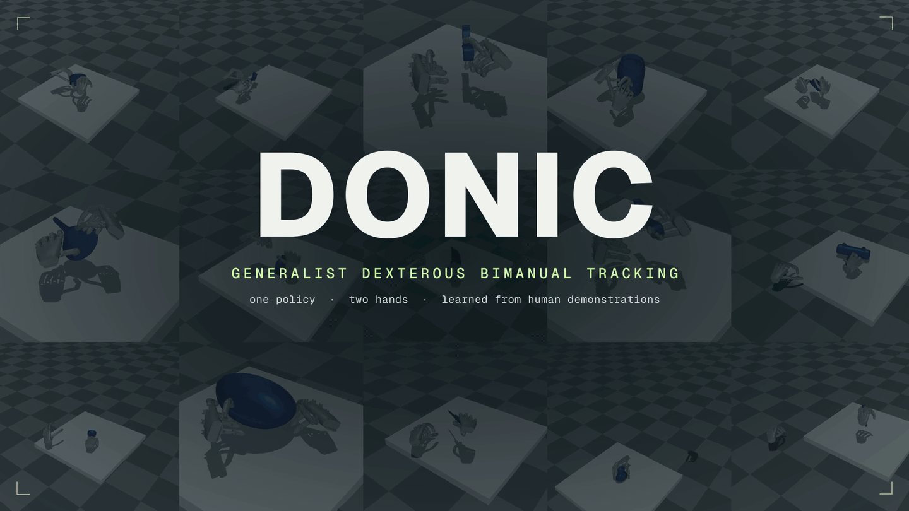

<h1 align="center">DONIC: Generalist Dexterous Bimanual Tracking Control from Human Demonstrations</h1>

<p align="center">
  Mingze Sun,
  Ziang Cao,
  Yuan Fei,
  Qiankuan Tao,
  Zihan Wang,
  Tianqi Liu,
  Junhao Chen,
  Haiwen Diao,
  Fangzhou Hong,
  Zhaoxi Chen,
  Ziwei Liu<sup>†</sup>
</p>

<p align="center">
  Ropedia
</p>

<p align="center">
  <sup>†</sup>Corresponding author
</p>

<p align="center">
  <a href="https://ropedia.github.io/DONIC/"></a>
  
  <a href="./demo.mp4"></a>
  <a href="https://github.com/Ropedia/DONIC"></a>
  
</p>

<p align="center">
  <a href="./demo.mp4"></a>
</p>

## Release

The DONIC code will be released in this repository, together with the BiHOI
dataset and DONIC policy weights.

| Resource | Status |
| --- | --- |
| DONIC training and evaluation code | coming soon |
| 🤗 BiHOI dataset | coming soon |
| DONIC policy weights | coming soon |

## Citation

```bibtex
@article{sun2026donic,
  title   = {DONIC: Generalist Dexterous Bimanual Tracking Control from Human Demonstrations},
  author  = {Sun, Mingze and Cao, Ziang and Fei, Yuan and Tao, Qiankuan and Wang, Zihan and Liu, Tianqi and Chen, Junhao and Diao, Haiwen and Hong, Fangzhou and Chen, Zhaoxi and Liu, Ziwei},
  journal = {Ropedia Technical Report},
  year    = {2026}
}
```
