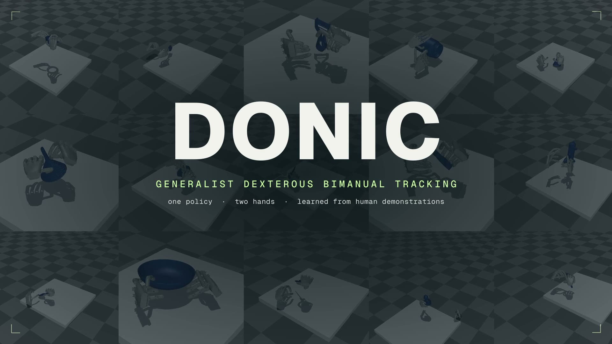

# DONIC: Generalist Dexterous Bimanual Tracking Control from Human Demonstrations

<a href="https://arxiv.org/abs/2610.29997"></a>
<a href="https://ropedia.github.io/DONIC/"></a>
<a href="./demo.mp4"></a>
<a href="bihoi_pipeline/"></a>


https://github.com/user-attachments/assets/13836832-63da-4767-8acb-2be188fbb6aa

**DONIC** is a generalist dexterous bimanual tracking policy: a **single policy** learns to track diverse **human two-hand demonstrations** with two robot hands, and generalizes to **unseen trajectories and unseen objects without fine-tuning**. It is trained on references from five public hand–object datasets and **BiHOI**, our new multi-view bimanual interaction dataset.

## 🔥 Highlights

- **Policy: One Policy, Two Hands.** A single reference-conditioned policy controls two Wuji dexterous hands and tracks bimanual references across operation categories and human-motion sources.
- **Data: BiHOI.** 1,575 multi-view bimanual sequences over 229 objects and 14.77 hours of interaction, captured with a calibrated multi-view camera array and emphasizing sustained two-hand contact.
- **Learning: Signals Built for Two Hands.** An object-centered per-hand reward, Clip-Centered Advantages, and a PPO + behavioral cloning loop that recycles replay-verified successful executions into training demonstrations.
- **Generalization: Zero Fine-Tuning.** Trained on public data, DONIC reaches 86.79% success on unseen trajectories and 57.32% on unseen objects in simulation, 77.36 and 45.73 percentage points above the stronger of our bimanual adaptations of DexTrack and Dexplore.
- **Scaling: More Human Data Helps.** Adding BiHOI improves all seven metrics on both held-out splits, raising success to 88.68% and 59.76%.

## 📝 To-Do List

- [x] Release technical report
- [x] Release project page
- [x] Release BiHOI processing pipeline ([`bihoi_pipeline/`](bihoi_pipeline/README.md))
- [ ] Release DONIC training and evaluation code ([`donic/`](donic/README.md))
- [ ] Release DONIC policy checkpoints
- [ ] Release BiHOI dataset

## 📂 Repository Structure

| Folder | Contents |
| --- | --- |
| [`bihoi_pipeline/`](bihoi_pipeline/README.md) | Multi-view hand–object interaction processing pipeline used to build BiHOI: masks, metric depth, object mesh, 6D object tracking, bimanual MANO hands, standardized export and a WebUI |
| [`donic/`](donic/README.md) | DONIC training and evaluation code (coming soon) |

## ⚖️ License

- **BiHOI pipeline:** code written for the pipeline is released under [CC BY-NC 4.0](bihoi_pipeline/LICENSE). Third-party components keep their own licenses, including non-commercial terms for EasyMocap and FoundationPose; see [`bihoi_pipeline/THIRD_PARTY.md`](bihoi_pipeline/THIRD_PARTY.md).
- Model weights, MANO assets and datasets used by the pipeline are not distributed here and remain subject to their original licenses.

## 📚 Citation

```bibtex
@article{sun2026donic,
  title={DONIC: Generalist Dexterous Bimanual Tracking Control from Human Demonstrations},
  author={Sun, Mingze and Cao, Ziang and Fei, Yuan and Tao, Qiankuan and Wang, Zihan and Liu, Tianqi and Chen, Junhao and Diao, Haiwen and Hong, Fangzhou and Chen, Zhaoxi and Liu, Ziwei},
  journal={arXiv preprint arXiv:2610.29997},
  year={2026}
}
```

## 🙏 Acknowledgments

We thank the authors of the following projects and datasets.

<details>
<summary><b>Tracking baselines and simulation</b> — click to expand</summary>

- [DexTrack](https://arxiv.org/abs/2502.09614)
- [Dexplore](https://arxiv.org/abs/2509.09671)
- [AdaDexTrack](https://janebek.github.io/AdaDexTrack/)
- [Isaac Gym](https://arxiv.org/abs/2108.10470)

</details>

<details>
<summary><b>Reconstruction and annotation</b> — click to expand</summary>

- [SAM 3](https://arxiv.org/abs/2511.16719)
- [MV-SAM3D](https://arxiv.org/abs/2603.11633)
- [Depth Anything 3](https://github.com/ByteDance-Seed/Depth-Anything-3)
- [FoundationPose](https://github.com/NVlabs/FoundationPose)
- [WAPR](https://github.com/WangYuLin-SEU/WAPR)
- [WiLoR](https://github.com/rolpotamias/WiLoR)
- [MANO](https://mano.is.tue.mpg.de/)
- [FMHR](https://github.com/agnJason/FMHR)
- [EasyMocap](https://github.com/zju3dv/EasyMocap)

</details>

<details>
<summary><b>Hand–object datasets</b> — click to expand</summary>

- [GRAB](https://grab.is.tue.mpg.de/)
- [OakInk2](https://openaccess.thecvf.com/content/CVPR2024/html/Zhan_OAKINK2_A_Dataset_of_Bimanual_Hands-Object_Manipulation_in_Complex_Task_CVPR_2024_paper.html)
- [TACO](https://taco2024.github.io/)
- [GigaHands](https://openaccess.thecvf.com/content/CVPR2025/html/Fu_GigaHands_A_Massive_Annotated_Dataset_of_Bimanual_Hand_Activities_CVPR_2025_paper.html)
- [H2O](https://taeinkwon.com/projects/h2o/)

</details>
